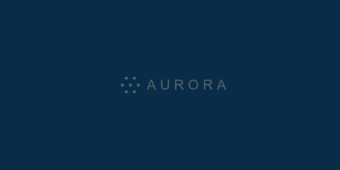

# Android BootAnimation 一键生成工具 (Android 原生光影扫光效果)

只需提供单张图片（如企业 Logo、个人标志或文字图形），即可自动制作出带有经典 **Android 原生光影掠过（Shimmer / Sweep Sheen）动效**的开机动画包 `bootanimation.zip`。

---

## 📽️ 效果预览

| 经典纯黑背景（方案 A） | 全屏主题色延展（方案 B） |
| :---: | :---: |
|  |  |

---

## 🌟 核心特性

1. **单图一键生成**：
   - 无论输入是透明 PNG、纯黑底 JPG、纯白底图片、灰度图，还是**深海蓝/任意彩色纯色背景**，内置智能去底与自适应居中算法。
2. **还原 Android 原生质感光影**：
   - 模拟经典斜向光刃扫光效果（倾角、光芯、柔光漫反射层与边缘光晕叠加）。
   - 两段式动画设计：`part0`（Logo 优雅淡入）+ `part1`（无缝循环光影掠过并伴随自然呼吸停顿）。
3. **全屏主题色延展（方案 B 无缝沉浸）**：
   - 自动检测并提取图片边缘底色，将整张屏幕（如 1080x2400）铺满相同底色，消除任何黑边与矩形色块割裂感。
   - 在 `desc.txt` 中自动写入 `#RRGGBB` 颜色标识，Android 系统级平滑加载不闪烁。
4. **严格遵循 Android AOSP 规范**：
   - **`ZIP_STORED` 0% 零压缩打包**：保证 Android `bootanim` 守护进程能够正常流式读取与加载。
   - **`desc.txt` 规范**：严格使用 Unix `\n` (LF) 换行符与末尾保留空行。
5. **简洁现代桌面 UI（所见即所得）**：
   - 基于 `CustomTkinter` 构建现代深色模式界面。
   - **内置实时帧动画预览播放器**：支持播放/暂停/重播，拖动参数即时刷新预览。
   - 常见屏幕分辨率预设（主流手机 20:9、经典手机 16:9、车机/平板横屏、工控屏、自定义 WxH）。
   - 支持一键导出 `bootanimation.zip` 与 `preview.gif`（用于在电脑端快速分享预览）。
6. **双模支持**：
   - 桌面 GUI 图形化操作。
   - 命令行（CLI）支持，方便集成到自动化构建脚本中。

---

## 🚀 启动与使用

### 1. 图形界面运行（GUI）

直接双击运行目录下的 **`run.bat`**，或在命令行中执行：

```powershell
python main.py
```

#### 操作步骤：
1. **载入图片**：点击“浏览...”选择您的 Logo 图片，或点击“✨ 载入示例 Android Logo”体验。
2. **选择分辨率与帧率**：从下拉菜单中选择您的设备分辨率（例如 `1080 x 2400`），或勾选自定义输入。
3. **调整光效（可选）**：通过左下角的滑块微调光束倾角、光斑宽度、扫光耗时、基底亮度与光影色彩方案。
4. **实时预览**：右侧预览视窗会实时循环展示扫光动效。
5. **一键导出**：点击 **`⚡ 一键生成并导出 bootanimation.zip`**，选择保存位置即可！

---

### 2. 命令行模式运行（CLI）

适合批量处理或自动化集成：

```powershell
# 基础用法
python main.py -i assets/sample_logo.png -o bootanimation.zip

# 指定分辨率与帧率并同时导出预览动图
python main.py -i my_logo.png -o bootanimation.zip --res 1080x2400 --fps 30 --gif preview.gif

# 自定义光效参数
python main.py -i my_logo.png -o bootanimation.zip --speed 1.6 --pause 0.5 --angle 28 --color cyan
```

#### CLI 参数说明：
- `-i, --image`：输入图片路径（必填）。
- `-o, --output`：输出的 zip 文件名（默认 `bootanimation.zip`）。
- `--res`：分辨率，格式为 `宽x高`（例如 `1080x2400`、`1920x1080`，默认 `1080x2400`）。
- `--fps`：帧率（`30` 或 `60`，默认 `30`）。
- `--scale`：Logo 占屏幕画布的最大比例（0.3 ~ 0.85，默认 `0.6`）。
- `--bg-mode`：背景处理模式（`auto`、`keep`、`remove_black`、`remove_white`、`luminance`）。
- `--speed`：扫光完成一次所需时间（秒，默认 `1.4`）。
- `--pause`：两次扫光之间的呼吸停顿时长（秒，默认 `0.6`）。
- `--angle`：光束倾斜角度（0° ~ 45°，默认 `25.0`）。
- `--color`：光影色彩方案（`white`、`cyan`、`green`、`gold`，默认 `white`）。
- `--gif`：可选，同时导出预览 GIF 动图的保存路径。

---

## 📱 将 bootanimation.zip 部署到 Android 设备

> [!IMPORTANT]
> 替换开机动画通常需要设备具备 **Root 权限** 或通过 **TWRP Recovery / Magisk 模块** 替换。

### 方法一：通过 ADB 替换（Root 设备）

```bash
# 连接设备并获取 root 权限
adb root
adb remount

# 备份原动画（可选）
adb pull /system/media/bootanimation.zip ./bootanimation_backup.zip

# 推送新动画到系统目录
adb push bootanimation.zip /system/media/bootanimation.zip

# 设置正确的文件权限（必须为 644 / rw-r--r--）
adb shell chmod 644 /system/media/bootanimation.zip

# 重启设备测试开机动画
adb reboot
```

*(注意：Android 10+ 的部分系统开机动画可能存放于 `/product/media/bootanimation.zip`)*

### 方法二：在测试环境中实时预览（无需重启手机）

在设备连上 ADB 且有 root 权限时，可直接通过命令在屏幕上测试播放：

```bash
adb shell bootanimation
```
按 `Ctrl+C` 即可退出测试。

---

## 🛠 项目结构

```text
bootanimation/
├── run.bat                     # Windows 快速双击启动脚本
├── main.py                     # 入口主程序 (GUI / CLI)
├── core/
│   ├── image_processor.py      # 图片预处理与自适应布局
│   ├── anim_engine.py          # 原生质感光影算法核心
│   ├── zip_builder.py          # Android 合规打包器与合规校验
│   └── gif_exporter.py         # 预览动图生成器
├── ui/
│   ├── app.py                  # CustomTkinter 桌面应用主界面
│   └── preview_canvas.py       # 实时交互帧动画画布
├── assets/
│   └── sample_logo.png         # 示例 Logo 资源
└── tests/
    └── test_engine.py          # 自动化验证单元测试
```
